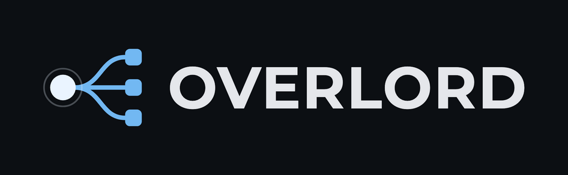

<p align="center">
  
</p>

# Overlord

A local web-based project multiplexer with integrated Claude AI agents. Manage multiple projects, chat with Claude in the context of each project, track todos, and run terminals from one interface.

## Features

- **Multi-project management** lets you scan a directory for git repositories and switch between them instantly.
- **Claude AI chat per project** gives each project its own Claude conversation scoped to that codebase, with streaming responses and tool access.
- **Todos / Backlog** tracks ideas and tasks per project, then lets you launch them directly into the chat.
- **Integrated terminal access** opens your preferred terminal application in the selected project's directory.
- **Monorepo support** detects workspace packages from pnpm, yarn, npm workspaces, nx, and lerna.
- **Persistent state** keeps chat history, todos, and project settings across server restarts with SQLite.
- **MCP server support** lets Claude agents read and write Overlord todos through the MCP protocol.
- **Auto-summaries** generate project summaries automatically after conversations (in this fork, only while the Summary tab is shown).

## What this fork adds

Everything below is documented in detail in [`docs/FORK-NOTES.md`](docs/FORK-NOTES.md) (in French).

- **Per-turn diff and undo.** Under each turn that changed files, a line shows `N files changed · View diff · Undo turn`. The diff window lets you undo a whole turn, one file, or a single block (hunk). Undo applies the reverse patch on the working tree, never touches the conversation, and is refused while the agent runs.
- **Rollback that keeps your staging.** The git snapshot taken before each message uses a temporary index, so what you had staged stays staged, also after a rollback.
- **Parallel work with git worktrees.** Branch a conversation from any message and tick *Isolate in a worktree*: the branch gets its own folder under `~/.overlord/worktrees/` and its own git branch `overlord/<name>`, so two agents can work on the same repo at the same time. `/merge` brings the work back.
- **Chat commands** handled by Overlord itself (table below).
- **A calmer chat.** One reading column, consecutive tool calls folded into one `N tool calls` line (with live status while the agent works), a single tooltip style, session usage in a popover instead of a permanent line, a dark palette with one accent and semantic colours.
- **Visible tabs.** *Settings → Visible tabs* hides the tabs you do not use (Marketing, Summary and Insights are hidden by default). Hiding Summary also stops the extra Claude calls (project summary and learnings) that otherwise run after every turn.
- **Insights costs priced per model** instead of at one flat Opus rate; models without a known price are reported, never guessed.
- **A quieter CodeGraph suggestion**, and the `.codegraph/` folder is hidden from `git status`, snapshots and diffs (locally, through `.git/info/exclude`).

### Chat commands

| Command | What it does |
|---|---|
| `/model [name]` | Show or change the model of this project |
| `/stop` | Stop the running agent |
| `/cost` | Tokens and cost of the session |
| `/branch` | List branches; `/branch <name>` switches, `/branch -c <name>` creates, `/branch -d <name>` deletes (merged only) |
| `/clear` | Next message starts a fresh Claude session. The conversation on screen is kept, the agent no longer sees it |
| `/resume` | List this project's Claude sessions; `/resume <n or id>` continues one |
| `/plan [on\|off]` | Plan mode: the agent reads and proposes without editing files |
| `/worktree` | State of this branch's worktree; `/worktree -d` removes it (`--force` to discard unsaved work) |
| `/merge` | Bring a worktree branch back: commit, merge into its base branch, clean up. `/merge --pr` pushes it and opens a PR on the project's own `origin` instead (GitHub and the `gh` CLI required) |
| `/help` | List these commands |

`/merge` is meant to be re-run: when it needs the agent (to commit, or to resolve conflicts) it hands it the task and stops, and you run it again once the agent is done. Other `/` entries are skills and commands run by the agent; interactive CLI commands such as `/compact` or `/permissions` do nothing in this headless mode.

## Prerequisites

- [Node.js](https://nodejs.org/) >= 18
- [Claude Code CLI](https://docs.anthropic.com/en/docs/claude-code) installed and authenticated
- Run Overlord with the **same Node version you ran `npm install` with** (this fork is developed on Node 22): the native module `better-sqlite3` is built for it. See [Troubleshooting](#troubleshooting).
- Optional: the [`gh` CLI](https://cli.github.com/), only for `/merge --pr`.

## Quick Start

```bash
# Clone the repo
git clone https://github.com/poptocrack/overlord.git
cd overlord

# Install dependencies (also installs and configures RTK automatically)
npm install

# Start the dev server (backend + frontend)
npm run dev

# Open http://localhost:4748 in your browser
```

`npm install` automatically sets up [RTK](https://github.com/rtk-ai/rtk) (Rust Token Killer) which reduces token consumption by 60-90% for Claude agents. If you prefer to skip this, set `RTK_SKIP=1` before installing.

On first launch, click **"Scan projects"** in the sidebar to detect git repositories.

### Desktop app (Electron)

```bash
OVERLORD_NODE_PATH="$(which node)" npm run dev:electron
```

`OVERLORD_NODE_PATH` makes Electron start the backend with your Node instead of `ELECTRON_RUN_AS_NODE`, which has no Web globals and crashes with `Class extends value undefined`.

## Configuration

### Root Directory

By default, Overlord scans the **parent directory** of where the server is running. To scan a different directory:

```bash
OVERLORD_ROOT=/path/to/your/projects npm run dev
```

For example:
```bash
# Scan ~/Projects instead of the default
OVERLORD_ROOT=~/Projects npm run dev
```

### Port

The backend runs on port `4747` and the frontend dev server on `4748`. To change:

```bash
PORT=5000 npm run dev
```

### Claude CLI Path

If `claude` is not in your PATH:

```bash
CLAUDE_PATH=/path/to/claude npm run dev
```

## Project Structure

The `server/` directory contains the Hono backend, SQLite setup, routes, WebSocket handling, MCP integration, and Claude agent orchestration.

The `src/` directory contains the React frontend, including the main layout, sidebar, chat, todos, settings, skills, summaries, and reusable UI components.

The `bin/overlord.js` file is the CLI entry point, while `package.json` defines scripts and dependencies.

## Tech Stack

| Layer | Technology |
|-------|-----------|
| Frontend | React, Vite, Tailwind CSS v4, shadcn/ui |
| Backend | Hono, Node.js |
| Database | SQLite via better-sqlite3 + Drizzle ORM |
| AI | Claude Code CLI (`--print --output-format stream-json`) |
| Token optimization | [RTK](https://github.com/rtk-ai/rtk) (60-90% token savings on shell commands) |
| Protocol | WebSocket (chat streaming), MCP |

## Scripts

```bash
# Web build and release
npm run dev          # Start backend + frontend (hot reload)
npm run dev:server   # Backend only (with watch)
npm run dev:client   # Frontend only
npm run build        # Production build

# Electron build and release
npm run build:electron       # Build frontend, backend, and Electron entrypoints
npm run dev:electron         # Build and launch the Electron desktop app
npm run prepare:electron-package # Prepare the isolated Electron packaging folder
npm run dist:electron        # Package desktop binaries for the current platform
npm run dist:electron:mac    # Package macOS binaries
npm run dist:electron:win    # Package Windows binaries
npm run dist:electron:linux  # Package Linux binaries
```

```bash
# Before every commit
npx tsc --noEmit -p . && npx vite build

# Regenerate every logo asset (favicons, desktop icons, README images) from scripts/build-logo.cjs
npx electron scripts/build-logo.cjs
```

## macOS Release Install

The macOS builds published on GitHub are unsigned. If macOS says `Overlord` is damaged after you install it from the DMG, remove the quarantine flag:

```bash
xattr -dr com.apple.quarantine /Applications/Overlord.app
```

Then open Overlord again from `/Applications`.

## Data Storage

All data is stored in `~/.overlord/overlord.db` (SQLite). This includes:
- Project registry (scan results, favorites, hidden state)
- Chat conversations and messages
- Todos
- Auto-generated summaries

The database is created automatically on first run. Next to it, `~/.overlord/settings.json` holds the workspace root and the hidden tabs, and `~/.overlord/worktrees/` holds the git worktrees of isolated branches (outside every repo, so they never show up in a project's `git status`).

## Working on this fork

- `origin` is your fork and `upstream` is [poptocrack/overlord](https://github.com/poptocrack/overlord). One branch per change (`feat/...`, `fix/...`), checked with `npx tsc --noEmit -p . && npx vite build`, then merged into `main`.
- Pick up the author's changes:
  ```bash
  git switch main && git pull upstream main && npm install && git push origin main
  ```
- Open PRs on **your fork**, not on the upstream repo. `gh` defaults to the upstream repo of a fork, so set the default once and fetch before using `--fill`:
  ```bash
  gh repo set-default <your-user>/overlord
  git fetch origin
  gh pr create --base main --head <branch> --fill
  ```
- Test the server logic without touching your data or spending tokens: run scripts with a throwaway `HOME` (`HOME=$(mktemp -d) npx tsx script.mts`, the database and worktrees live under `~/.overlord`), and point `CLAUDE_PATH` at a fake script that prints the same stream the real CLI does.

## Troubleshooting

| Symptom | Fix |
|---|---|
| `NODE_MODULE_VERSION X ... requires Y` when the backend starts | The Node version differs from the one used for `npm install`. `nvm use` that version (or `nvm alias default 22`), or run `npm rebuild better-sqlite3` |
| Electron: `Class extends value undefined` | Start it with `OVERLORD_NODE_PATH="$(which node)"` (see above) |
| macOS: the agent or a script gets `Operation not permitted` in `~/Desktop` | Most likely a macOS privacy restriction on that folder. Allow your terminal (and Claude Code) in *System Settings → Privacy & Security → Files and Folders*, or keep projects outside Desktop, Documents and Downloads; `tccutil reset SystemPolicyDesktopFolder` then a restart can reset a stuck permission |
| `gh pr create --fill`: `unknown revision origin/main` | `git fetch origin` first |
| The Dock still shows the old icon | macOS caches icons: wait a few minutes or restart the app |
| A tab you use is missing | It is hidden: *Settings → Visible tabs* |

## License

MIT
